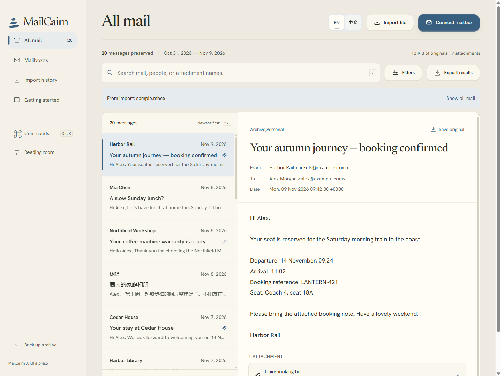
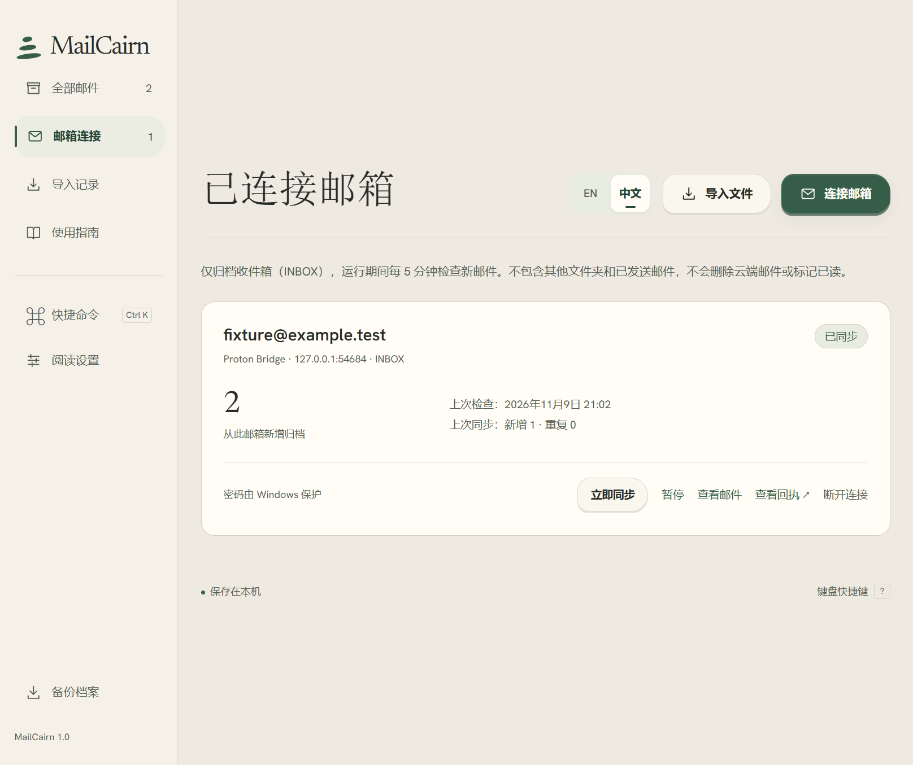

# MailCairn · 0.1.0-alpha.9

**English** | [简体中文](README.zh-CN.md)

**Keep old mail searchable, on your own computer.**

MailCairn preserves your email in a single persistent SQLite archive on your machine. Import extracted `.mbox` or `.eml` files with no account setup, or connect a supported mailbox to archive new INBOX mail automatically while the app runs. Search subjects, people, message bodies and attachment names, read mail as safe inert plain text, recover original `.eml` messages and attachments, and verify stored archive hashes. No Docker, hosted service, Node.js runtime or AI model is required.

[**Download for Windows (64-bit)**](https://github.com/Osmanthusfish/mailcairn/releases/download/v0.1.0-alpha.9/MailCairn-0.1.0-alpha.9-windows-x64.zip) · [Download source ZIP](https://github.com/Osmanthusfish/mailcairn/releases/download/v0.1.0-alpha.9/MailCairn-0.1.0-alpha.9-source.zip) · [Release notes and SHA-256 checksums](https://github.com/Osmanthusfish/mailcairn/releases/tag/v0.1.0-alpha.9)

[Architecture](docs/architecture.md) · [Verification report](docs/test-results.md) · [Research & sources](docs/market-research.md) · [License](LICENSE)



## Start the alpha

> **Alpha preview (`0.1.0-alpha.9`):** This is an unsigned pre-release build; keep your original mail exports and a separate backup. Real Gmail initial import passed (120 messages), while subsequent automatic new-message polling remains affected by an unresolved TLS connection reset; paid Proton Bridge testing, a clean second Windows computer and independent security review remain outstanding. Detailed iteration history and artifact checksums are in [RELEASE_NOTES.md](RELEASE_NOTES.md), [ALPHA.md](ALPHA.md) and [test results](docs/test-results.md). Original EML downloads and archive backups preserve stored bytes; MBOX export is a compatibility conversion.

### Windows ZIP — no Python installation needed

1. Extract **all** of `MailCairn-0.1.0-alpha.9-windows-x64.zip` into a folder you choose. Do not run it inside the ZIP or copy only the EXE.
2. Open that folder and double-click **MailCairn.exe**. Keep its control window open; your archive opens in the browser. The package includes Python **3.13.17**.
3. Choose **Import file** to add your exported mail. For automatic archiving, see **Getting started → Connect a mailbox**.

No source checkout, development folder or previous installation is needed. The default archive is `%LOCALAPPDATA%/MailCairn/archive.sqlite3`. **Restore backup…** validates a backup into a new folder; **Open archive folder…** reopens an archive. Quit an older MailCairn version normally before starting this release; refreshing its browser tab does not upgrade its backend. The executable is unsigned. Runtime contents and licenses are listed in the [desktop audit](docs/desktop-dependencies.md) and [bundled notices](licenses/desktop/README.txt).

### Source ZIP — Python required

Extract `MailCairn-0.1.0-alpha.9-source.zip`, open a terminal in the extracted folder containing `app.py`, then run:

```sh
python app.py
```

Use **Python 3.11 or later with SQLite FTS5** and a current desktop browser. On macOS/Linux the command may be `python3 app.py`. The source app uses the Python standard library and local HTML/CSS/JavaScript: no pip packages, Node.js, Docker or build step are needed to run it. Source mode defaults to `data/archive.sqlite3` beside `app.py`.

Windows users may also double-click `Start-MailCairn.cmd`. Run `python desktop.py` or `Start-MailCairn-Desktop.cmd` for the optional Windows control window; this source entry requires Python with Tkinter. On macOS/Linux, `sh start-mailcairn.sh` starts the browser version. These instructions do not require neighboring development or deliverables folders.

The server listens only on `127.0.0.1`. Keep the terminal open and use `Ctrl+C` to stop it. If the browser does not open, copy the **complete launch URL** from the terminal. It contains a temporary session token; keep it private. `python app.py --open-existing` reopens a verified running archive. Do not delete archive lock files or restore into an active archive.

Click **EN / 中文** in the page header or any dialog to switch language. The first visit follows the browser language; later visits remember the choice. Interface copy, dates and counts change; messages remain untouched.

## Automatically archive new mail

Choose **Connect mailbox**, then manage it under **Mailboxes**. The form keeps ports under **Advanced settings** and technical details in **Getting started → Connect a mailbox**. **How to connect your mailbox** opens the relevant instructions directly; [the bilingual setup guide](docs/mailbox-setup-guide.md) is also included with the source. The initial UI checks **INBOX only, every five minutes while the desktop control window or source server remains running**; use **Sync now** for an immediate attempt. The first connection also archives existing INBOX mail. Pause stops subsequent automatic attempts; disconnect removes the connection and attempts to delete its saved credential, keeping archived messages. If credential cleanup fails, a visible warning explains that the password may remain locally; the connection stays disconnected. Closing only the browser reader does not stop the local service. Quitting the app stops synchronization.

- **Gmail:** use an app password where your account allows it, not your ordinary Google password. This requires 2-Step Verification and may be unavailable under organization or Advanced Protection policies. This version does not provide Google OAuth sign-in.
- **Proton Mail:** requires a **paid Proton Mail plan and the local Proton Mail Bridge**. Use Bridge's displayed username, password and port. **Proton Free and an already signed-in Proton browser tab do not enable this connector.** The free export tool remains a manual import route.
- **Other IMAP:** use the provider's IMAP-over-TLS host, port and supported credential. This version archives INBOX; Sent and other folders are outside its scope.

After a connection error, MailCairn retries while it is running, the mailbox is unpaused and its password remains available. Retries do not guarantee recovery. Saved mail remains available, and you can import a mail file while leaving other apps running. A network error alone does not mean your app password is wrong; authentication errors still offer **Reconnect**. Gmail opening in a browser does not establish that its mail connection is reachable.

The connector reads without changing flags, moving or deleting source messages. Archived messages remain if their source is later deleted. Mail moved out of INBOX or deleted before a check may never be captured. Watch connection status and errors: a size/parse failure stops before the affected message so it can be retried, rather than silently advancing past it. Provider access details and verification boundaries are in [sync research](docs/mail-sync-research.md); actual executed checks are in [test results](docs/test-results.md).

Remembered passwords use per-user **Windows DPAPI when its capability check succeeds**; other systems or restricted Windows contexts keep credentials only in process memory and disable remembering. Mail archives remain unencrypted. Connection configuration, progress and credentials are separate from the downloaded SQLite backup: reconnect accounts after restoring into a new directory. Keep credential files private and out of source releases.



## Your first file archive

1. Obtain a mail export from your provider or email client and extract any ZIP/TGZ archive first. MailCairn accepts `.mbox` and individual `.eml` files.
2. Choose **Import file**, select your files, and wait for both transfer and indexing to finish. **Choose folder** includes MBOX/EML in nested directories and reports the number of skipped non-mail files, including Proton JSON sidecars. Folder structure/JSON metadata are not reconstructed. The transfer is from your browser to the local Python process on the same computer.
3. Counts and the mail list refresh after each processed file using confirmed archive data. The compact completion review keeps successful, partial and failed outcomes visible, including files that never started after a stopped queue. Download its JSON receipt for record numbers, byte offsets, hashes and skipped-message reasons. **View imported mail** opens a single import; **View mail** opens the archive for a multi-file batch. Keep the original export, especially if the result is partial.
4. Search by words in the subject, sender, recipients, body or attachment filename. Combine sender, inclusive date range and attachment filters. Open a message to read its plain-text preview or download its original EML/attachments.
5. Download an archive backup and test restoring it into a new data directory before relying on the archive as your only working copy.

For a harmless first run from the source distribution, import `tests/fixtures/sample.mbox`. Its messages and attachments are explicitly synthetic. A new archive starts empty; this fixture is never loaded automatically.

## What is included

| Need | Behavior |
| --- | --- |
| Reopen an old archive | Raw messages, metadata and the search index persist in one SQLite archive. The imported source file is not needed for later reading. |
| Import the same file again | SHA-256 of the stored raw message bytes prevents exact duplicates. Different content with the same Message-ID is retained. |
| Understand incomplete imports | Each recognized record has an outcome. Oversized or unparseable records are reported, not silently counted as stored. Cancellation retains committed messages; re-import to continue. |
| Find a receipt or attachment | Full-text search covers decoded message text and attachment names. Attachments are downloaded on demand. |
| Keep data portable | Download original EML, decoded attachments, filtered MBOX results, a full import receipt or a complete SQLite backup. |
| Check the stored archive | Verification checks SQLite integrity, the full-text index, stored message hashes and import-receipt counts/references. It does **not** prove that your provider exported every message. |

Mail HTML is converted to inert text. Scripts, tracking pixels, remote images and email hyperlinks are not executed or fetched by the reader. The app has no telemetry or CDN assets. An enabled mailbox connection contacts only its configured mail endpoint; Proton Bridge makes its own provider connection.

## Reading room and keyboard controls

Open **Reading room** in the sidebar to choose System, Daylight or Lamplight appearance; Cedar, Blue or Umber annotation ink; Small, Standard or Large reading type; and Comfortable or Compact catalogue spacing. Changes apply immediately. Preferences stay in this browser's local storage and are separate from archive backups. Invalid saved values fall back to defaults; if storage is unavailable, changes still work for the current visit.

The browser interface supports **English and Simplified Chinese**, including navigation, commands, import progress, receipts, verification results, guidance and accessibility labels. Language switching keeps the current filters, selected message and ongoing import. Original mail, filenames and unknown technical diagnostic details remain verbatim; known application errors and parser warnings are localized. The desktop control window also offers both languages.

Press **Ctrl/⌘ K** to open Commands. When a message row has keyboard focus, **↑/↓** moves through the current results and opens the selected message; Home/End moves to the first/last row on the page. The **Single-key shortcuts** switch controls `/` for search, `i` for import, `g` for mail, `h` for history, `,` for Reading room and `?` for Commands. Ctrl/⌘ K and list navigation remain available when that switch is off.

The interface bundles local Hanken Grotesk and Newsreader fonts, uses rounded controls and an underline search focus. Opening an empty archive plays the envelope entrance once for that page. Navigation follows the selected destination; import stages and confirmed outcomes receive brief transitions; selecting a message moves a decorative sheet toward the live reading surface. The mail itself stays immediately available. Font sources and separate OFL notices are documented in [font provenance](docs/font-provenance.md).

Disable **Motion** in Reading room to keep these interactions still. The operating system's reduced-motion setting always takes priority. Transitions are bounded and cancellable; effects stop on relevant view changes, when the page is hidden, or when their canvas leaves the viewport. The envelope has no replay control, and there is no separate decorative scene or light-preview control. Navigation, import review and reading remain usable with motion disabled.

## Configuration and restore

```sh
# Store the archive in a directory you choose.
python app.py --data-dir ./my-mail --port 8765

# Pick an available port; print the launch URL without opening a browser.
python app.py --port 0 --no-browser

# Raise the per-message limit for a known large attachment.
python app.py --max-message-mib 64 --max-upload-gib 30

# Restore a downloaded snapshot into a NEW data directory.
python app.py --data-dir ./restored-mail --restore-backup ./mailcairn-backup.sqlite3
```

Source launches default to `data/archive.sqlite3` beside `app.py`; the packaged desktop candidate defaults to `%LOCALAPPDATA%/MailCairn/archive.sqlite3`. A live archive can also have SQLite `-wal` and `-shm` files; use the app's backup download instead of copying a live database file. Restore refuses to overwrite an existing archive and checks the snapshot's schema, SQLite integrity, message hashes, search index and import receipts before publishing it. Restore requires a destination filesystem with hard-link support, such as NTFS on Windows; FAT/exFAT destinations are unsupported. The backup includes messages, attachments, the index and import receipts.

## Limits to know

- This is a **personal, single-computer archive** with optional INBOX polling while running. It does not send mail, delete cloud messages, synchronize devices or provide shared access. Proton Free automatic ingestion and Gmail OAuth are not supported in this connector version.
- The current parser supports conventional mboxo/mboxrd envelope lines. PST, OST, ZIP/TGZ, Maildir and mboxcl variants are not supported. Ambiguous or damaged MBOX boundaries cannot establish the true original message count.
- The default limits are **20 GiB per file** and **32 MiB per message**. These are configurable safety limits, not a performance guarantee. Oversized messages are skipped and identified in the receipt. Space is needed for the temporary upload, the archive and its index.
- Only the first **1,000,000 decoded body characters** are indexed and previewed; the original message remains intact. Attachment **contents** are not indexed. Plain text is preferred over HTML alternatives; complex visual layouts and inline images are omitted.
- Search uses all entered word tokens with AND semantics, not Gmail's query language. CJK queries use literal substring matching and may be slower on large archives. Date filters use the date written in the original Date header, and exclude messages with missing/invalid dates.
- Deduplication is byte-exact. MBOX export escapes lines beginning `From ` to `>From ` and removes top-level `Content-Length` headers and their continuations so readers do not mistake the export for unsupported mboxcl. Body text and MIME-part headers are retained. Re-import can change the raw hash and create another copy of the same logical message. MBOX is not a byte-exact roundtrip format here. Use original EML downloads or SQLite backup/restore to preserve stored message bytes.
- The database, exports, attachments and temporary files are **not encrypted by MailCairn**. Use your operating system's disk protection and keep backups private. Opening a downloaded attachment runs in another application with that application's security rules.
- The responsive browser layout is useful in a narrow desktop window. A server bound to loopback is not reachable from a separate phone.

Read [the security model](SECURITY.md), [known limits](docs/known-limits.md) and [test results](docs/test-results.md) for the actual verification scope. There is no claim of independent security certification, provider-level completeness, forensic chain of custody or validated product-market fit.

## Development

```sh
python -m unittest discover -s tests -v
node --check mailcairn/static/app.js
node --check mailcairn/static/i18n.js
node --check mailcairn/static/startup.js
node scripts/check_frontend.mjs
node scripts/check_i18n.mjs
node scripts/check_connections.mjs
node scripts/check_startup.mjs
python scripts/release_check.py
```

Node.js is needed only for these development checks; running MailCairn does not need Node.js or third-party application packages. The frontend scripts cover static contracts, selected state behavior and bilingual/folder-import regressions, not browser layout or accessibility validation.

The application uses Python's standard library and native HTML/CSS/JavaScript. The source distribution relies on separately installed Python; the desktop executable includes an interpreter, native libraries and PyInstaller runtime components with their own licenses. See [architecture](docs/architecture.md), the [source dependency audit](docs/dependency-audit.md), [desktop runtime audit](docs/desktop-dependencies.md), [runtime notices](licenses/desktop/README.txt), [working principles](AGENTS.md), [project handoff](HANDOFF.md) and [release checklist](docs/release-checklist.md). All fixtures are synthetic; do not add private mail to issues, commits or screenshots.

## Source availability and commercial rights

MailCairn is **source-available under the PolyForm Noncommercial License 1.0.0**, not OSI open source. Use, modification and redistribution are permitted only for purposes allowed by [LICENSE](LICENSE), including the license's explicitly defined personal and noncommercial-organization uses. Commercial use outside those permissions requires a separate written license from the rights holder.

The original rights holder retains the ability to earn revenue and grant separate commercial licenses. Publishing the source on GitHub does not grant commercial rights. See [commercial licensing](COMMERCIAL.md), [required notices](NOTICE) and [the contribution policy](CONTRIBUTING.md).
