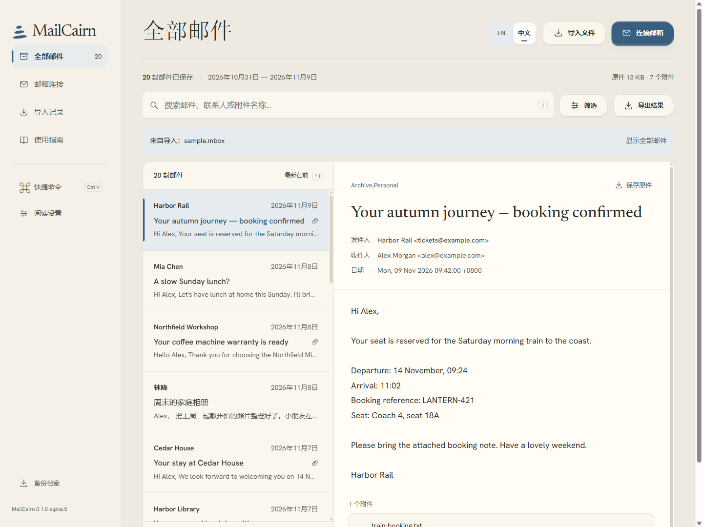
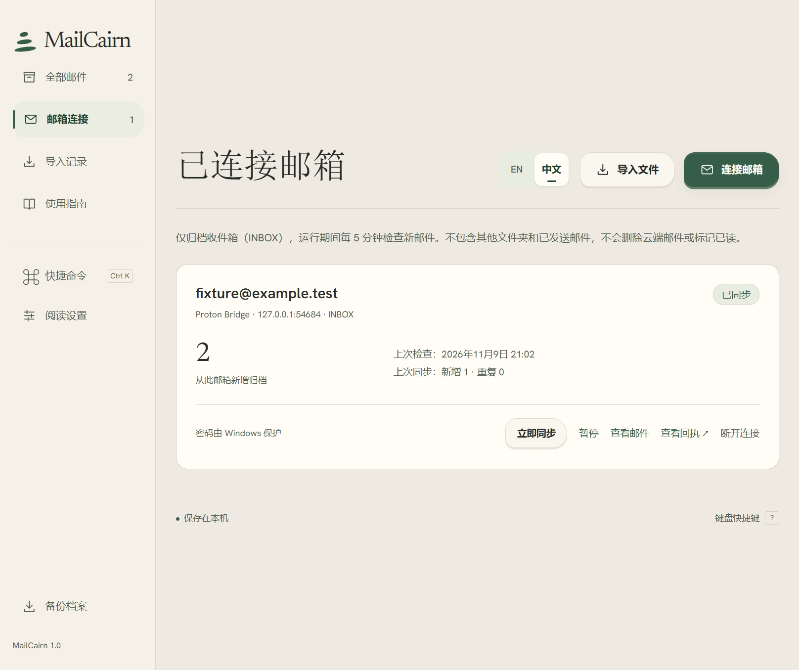

# MailCairn · 0.1.0-alpha.9

[English](README.md) | **简体中文**

**把旧邮件变成能随时查找的本地档案。**

MailCairn 将你的邮件持久保存在本机单一 SQLite 档案文件中。无需注册账号即可直接导入 `.mbox`／`.eml` 导出文件，或连接支持的邮箱在应用运行期间只读自动归档新的 INBOX 邮件；随时全文检索主题、联系人、正文与附件文件名，以安全的静态纯文本阅读信件、取回原始 `.eml` 与附件，并核对导入回执与档案哈希。运行无需 Docker、云服务、Node.js 环境或 AI 模型。

[**下载 Windows 64 位便携版**](https://github.com/Osmanthusfish/mailcairn/releases/download/v0.1.0-alpha.9/MailCairn-0.1.0-alpha.9-windows-x64.zip) · [下载源码包](https://github.com/Osmanthusfish/mailcairn/releases/download/v0.1.0-alpha.9/MailCairn-0.1.0-alpha.9-source.zip) · [版本说明与 SHA-256 校验值](https://github.com/Osmanthusfish/mailcairn/releases/tag/v0.1.0-alpha.9)

[架构设计](docs/architecture.md) · [测试报告](docs/test-results.md) · [调研与来源](docs/market-research.md) · [许可证](LICENSE)



## 启动 Alpha 版

> **Alpha 预览版说明（`0.1.0-alpha.9`）：** 当前为未签名的预览构建，请保留原始邮件导出文件与独立备份。真实 Gmail 首次 120 封归档已通过，后续自动轮询新信仍受未解决的 TLS 连接重置影响；付费 Proton Bridge、第二台干净 Windows 电脑与独立安全审查尚待完成。各版本改动细节与文件校验值见 [版本说明](RELEASE_NOTES.md)、[Alpha 检查清单](ALPHA.md)与[测试记录](docs/test-results.md)。原始 EML 下载和档案备份保留已存字节，MBOX 导出属于兼容性转换。

### Windows ZIP：无需安装 Python

1. 将 **MailCairn-0.1.0-alpha.9-windows-x64.zip 全部解压**到自选文件夹。不要在 ZIP 中运行，也不要只复制 EXE。
2. 打开解压后的文件夹，双击 **MailCairn.exe**。保留控制窗口，浏览器会打开档案。包内已包含 Python **3.13.17**。
3. 选择**导入文件**添加已导出的邮件。如需自动归档，请参阅应用内的**使用指南 → 连接邮箱**。

不需要源码目录、开发工作区或旧版安装。默认档案位于 `%LOCALAPPDATA%/MailCairn/archive.sqlite3`；“恢复备份…”会验证并恢复到新文件夹，“打开档案文件夹…”可重新打开已有档案。启动新版前请正常退出旧版控制窗口；只刷新旧网页不会升级后台。此 EXE 未签名。运行时组成和许可见[桌面审计](docs/desktop-dependencies.md)及[随附声明](licenses/desktop/README.txt)。

### 源码 ZIP：需要 Python

解压 `MailCairn-0.1.0-alpha.9-source.zip`，在包含 `app.py` 的解压目录打开终端，然后运行：

```sh
python app.py
```

需要 **Python 3.11 或更新版本，包含 SQLite FTS5**，以及当前版本的桌面浏览器。macOS／Linux 可能使用 `python3 app.py`。源码应用使用 Python 标准库和本地 HTML／CSS／JavaScript，运行时不需要 pip 包、Node.js、Docker 或构建。源码模式默认档案为 `app.py` 旁的 `data/archive.sqlite3`。

Windows 也可双击 `Start-MailCairn.cmd`；若要使用可选的 Windows 控制窗口，运行 `python desktop.py` 或 `Start-MailCairn-Desktop.cmd`，此源码入口需要带 Tkinter 的 Python。macOS／Linux 可运行 `sh start-mailcairn.sh`。以上步骤不依赖相邻开发目录或旧交付目录。

服务只监听本机 `127.0.0.1`。保持终端打开，按 `Ctrl+C` 退出。浏览器未自动打开时，请复制终端中的**完整启动链接**，其中含临时会话令牌，不要公开分享。`python app.py --open-existing` 可重新打开已验证的运行中档案。不要删除档案锁，也不要向正在使用的档案执行恢复。

在页面顶部或弹窗内点击 **EN／中文** 切换语言。首次按浏览器语言显示，之后记住选择；只改变界面文案、日期和数量，不改写邮件。

## 自动归档新邮件

点击**连接邮箱**添加账号，在**邮箱连接**中管理。端口收进**高级设置**，详细说明放在**使用指南 → 连接邮箱**；弹窗里的**如何连接邮箱**会直接打开对应说明。源码也附有[中英操作文档](docs/mailbox-setup-guide.md)。首版界面仅检查 **INBOX 收件箱**，在**桌面控制窗口或源码服务持续运行时，每 5 分钟**执行一次，也可点击**立即同步**；首次连接也会归档收件箱已有邮件。暂停会停止后续自动尝试；断开连接移除配置并尝试删除已保存凭据，保留已归档邮件。如果凭据清理失败，界面会提示密码可能仍保存在本机，账号仍保持断开。只关闭浏览器不会停止本机服务；退出应用会停止同步。

- **Gmail：** 使用账号允许创建的应用密码，不是普通 Google 密码；需要两步验证，组织策略或高级保护可能使其不可用。本版没有 Google OAuth 登录。
- **Proton Mail：** 必须有**付费 Proton Mail 套餐及本机 Bridge**，使用 Bridge 显示的用户名、专用密码和端口。**免费 Proton 账号或已经登录的网页不能启用此连接器**；免费导出工具仍是手动导入路径。
- **其他 IMAP：** 填写提供商的 IMAP TLS 主机、端口及有效凭据。首版不包含已发送或其他文件夹。

连接器只读抓取，不改已读标记、不移动、不删除源邮件；源端后来删除时，本地已保存邮件继续保留。检查前移出 INBOX 或已删除的邮件可能无法捕获。请查看连接状态与错误；遇到超限或无法解析的邮件会停在该邮件之前，保留重试机会，不会悄悄跳过进度。提供商条件见[同步研究](docs/mail-sync-research.md)，实际执行的验证见[测试记录](docs/test-results.md)。

**Windows DPAPI 能力检测通过时**可选择用当前用户密钥加密记住密码；其他系统或受限 Windows 环境仅在进程内存中保存，并禁用记住选项。邮件档案本身仍不加密。连接配置、同步进度和凭据不包含在下载的 SQLite 备份中；恢复到新目录后需要重新连接账号。凭据文件不得提交到源码或公开分享。

## 完成第一次文件归档

1. 先从邮箱服务或邮件客户端取得导出文件，并解压 ZIP／TGZ；应用只接收 `.mbox` 和 `.eml`。
2. 点击 **导入文件／Import file** 选择文件，等待本机传输和索引完成。“选择文件夹”会包含子目录中的 MBOX／EML，并报告跳过的非邮件文件数量（含 Proton 的 JSON 辅助文件）；不重建原文件夹或 JSON 元数据。文件只传给同一台电脑上的本地进程。
3. 每处理完一份文件，数量和邮件列表都会根据实际档案数据刷新。紧凑的完成区保留成功、部分导入和失败结果，队列停止后也会报告尚未开始的文件。可下载含记录编号、字节位置、哈希和跳过原因的 JSON 明细；单份导入点击“查看已导入邮件”，多文件批次点击“查看邮件”进入全部档案。尤其在部分导入时，应保留原始导出文件。
4. 搜索主题、发件人、收件人、正文或附件文件名，结合日期、发件人和有无附件筛选，打开邮件阅读或下载原始 EML／附件。
5. 下载完整档案备份，并恢复到一个新目录确认可以重新搜索、读取附件。

源码包中的 `tests/fixtures/sample.mbox` 可用于熟悉操作。该文件只包含明确标注的合成数据，新启动的档案不会自动加载样例。

## 产品差异

- **持久化档案**：原始邮件、附件、搜索索引和导入明细一起保存，后续查阅不依赖原 MBOX 路径。
- **可重复导入**：按原文字节的 SHA-256 去重。Message-ID 相同但内容不同的邮件会保留，避免误合并。
- **导入结果可核对**：识别出的记录逐条记录结果；超限、解析失败、取消与中断不会伪装成完整成功。重导入可继续补齐未保存的消息。
- **数据可带走**：支持原始 EML、附件、筛选结果 MBOX、JSON 明细和完整 SQLite 备份。
- **不渲染活动邮件内容**：HTML 转成纯文本，不执行脚本、不加载跟踪像素或远程图片；无遥测或 CDN。启用的邮箱连接会访问所配置的邮件端点，Proton Bridge 自行连接其提供商。

这不是没有竞品的市场。Thunderbird、MailStore Home、OpenArchiver 和多个 MBOX 查看器已经能够解决许多人的问题。当前范围是个人本机文件归档及可选的 INBOX 单向增量归档，不是完整邮箱客户端。原先手动导入定位的研究保留在[证据、反证与商业假设](docs/market-research.md)，新连接范围见[同步研究](docs/mail-sync-research.md)。

## 阅读设置与键盘操作

侧栏的 **阅读设置／Reading room** 可选择跟随系统／日光／灯下主题，雪松绿／墨蓝／赭褐三种主题色，小／标准／大阅读字号，以及舒适／紧凑列表密度。修改即时生效，偏好只保存在当前浏览器的本地存储中，不包含在档案备份里。损坏或不合法的偏好会回退到默认值；存储不可用时，设置仍可在本次访问中使用。

浏览器界面完整支持 **English／简体中文**，涵盖导航、快捷命令、导入进度、回执、核验结果、指南和可访问性标签。切换语言会保留当前筛选、所选邮件和进行中的导入。邮件原文、文件名和未知技术诊断保持原样；已知应用错误及解析提示提供翻译。桌面控制窗口也支持两种语言。

按 **Ctrl/⌘ K** 打开快捷命令。邮件行获得键盘焦点后，可用 **↑/↓** 在当前结果页中移动并打开邮件，用 Home/End 跳至本页首／末行。**单键快捷操作**开关控制单键操作：`/` 搜索、`i` 导入、`g` 邮件、`h` 历史、`,` 阅读设置、`?` 命令面板。关闭单键快捷键后，Ctrl/⌘ K 和列表导航仍然可用。

界面使用随项目附带的 Hanken Grotesk 与 Newsreader 字体，区分操作文字和阅读标题；按钮采用圆润形状，搜索框用下划线表示焦点。打开空档案页面时，信封自然展开一次。导航跟随所选页面，导入阶段和已确认结果使用短暂过渡，点选邮件时装饰纸张移向实际阅读区；邮件内容始终可以立即阅读。字体来源和独立 OFL 许可见[字体记录](docs/font-provenance.md)。

可在阅读设置中关闭**动态效果**；操作系统的“减少动态效果”设置始终优先。过渡都有明确时长并可中断，相关页面切换、页面进入后台或画布离开视口时会停止。信封不提供重播按钮，也没有独立装饰场景或光影预览入口。关闭动效后，导航、导入结果核对和阅读仍然正常可用。

## 配置与恢复

```sh
# 自选档案目录
python app.py --data-dir ./my-mail --port 8765

# 使用空闲端口，不自动打开浏览器
python app.py --port 0 --no-browser

# 提高单封邮件／单文件限制
python app.py --max-message-mib 64 --max-upload-gib 30

# 把下载的备份恢复到新目录；不会覆盖现有档案
python app.py --data-dir ./restored-mail --restore-backup ./mailcairn-backup.sqlite3
```

源码版默认保存在项目的 `data/archive.sqlite3`，打包桌面候选版默认保存在 `%LOCALAPPDATA%/MailCairn/archive.sqlite3`。运行中的数据库可能还有 `-wal`／`-shm` 文件，**不要只复制正在使用的主数据库文件作为备份**，请使用应用提供的完整快照下载。恢复前会检查格式、SQLite 完整性、邮件字节哈希、搜索索引和导入明细；验证通过后才原子创建档案。恢复目标文件系统需要支持硬链接，例如 Windows 的 NTFS；不支持 FAT／exFAT 目标。

## 当前边界

| 项目 | 说明 |
| --- | --- |
| 输入格式 | 常见 mboxo／mboxrd 和 EML；不支持 PST、OST、ZIP／TGZ、Maildir、mboxcl。损坏或模糊的 MBOX 边界无法证明真实原始邮件数。 |
| 默认限制 | 每文件 20 GiB、每封邮件 32 MiB，可通过命令行调整；这不是已验证性能上限。超限邮件会跳过并写入明细。 |
| 搜索范围 | 解码后的主题、地址、正文、附件名；不搜索附件内部内容。不支持 Gmail 查询语法；多个词按 AND 匹配，中文等 CJK 查询采用子串匹配，大档案可能较慢。 |
| 阅读范围 | 最多索引和预览 1,000,000 个正文字符，完整原文仍保存；HTML 布局、内嵌图片不显示。 |
| 去重与 MBOX 往返 | 字节完全一致才去重。MBOX 导出会把行首的 `From ` 转义成 `>From `，并移除顶层 `Content-Length` 头及折行，避免被读信软件误认成不支持的 mboxcl；正文和 MIME 子部件头保持不变。再次导入可能改变原文哈希并生成重复副本，不保证字节一致的往返。需要保留已存字节时，使用原始 EML 下载或 SQLite 备份／恢复。 |
| 完整性 | 校验检查本地 SQLite、索引、已保存邮件哈希，以及导入明细计数与消息引用的一致性，不能证明邮箱服务没有漏导出，也不是法律证据链。 |
| 隐私 | 本地数据库、临时文件、导出与附件没有应用级加密；请使用系统磁盘保护。下载附件后的打开行为由其他应用负责。 |
| 使用形态 | 个人单机，可选运行时 INBOX 定时归档；不发信、不删除云端邮件、不支持多人或跨设备同步。Proton 免费账号自动归档及 Gmail OAuth 尚不支持。窄屏布局不代表可从另一台手机访问本机服务。 |

调研尚未验证付费意愿或长期留存。当前限制见[已知边界](docs/known-limits.md)，实际测试环境、结果和规模见[测试记录](docs/test-results.md)，不要将配置上限理解成性能承诺。

## 开发与发布

```sh
python -m unittest discover -s tests -v
node --check mailcairn/static/app.js
node --check mailcairn/static/i18n.js
node --check mailcairn/static/startup.js
node scripts/check_frontend.mjs
node scripts/check_i18n.mjs
node scripts/check_connections.mjs
node scripts/check_startup.mjs
python scripts/release_check.py
```

Node.js 仅供上述开发检查使用，运行 MailCairn 不需要 Node.js 或第三方业务包。前端检查脚本覆盖静态约定、部分状态行为和双语／文件夹导入回归，不能替代真实浏览器的布局与可访问性检查。

源码分发使用另行安装的 Python；桌面可执行包包含解释器、原生库和 PyInstaller 运行时组件，各自保留独立许可。参见[架构](docs/architecture.md)、[源码依赖许可证检查](docs/dependency-audit.md)、[桌面运行时审计](docs/desktop-dependencies.md)、[运行时声明](licenses/desktop/README.txt)、[安全说明](SECURITY.md)、[发布检查表](docs/release-checklist.md)、[项目工作原则](AGENTS.md)和[智能体交接记录](HANDOFF.md)。测试、截图仅可使用合成数据，不要提交真实邮件、数据库或启动令牌。

## 使用许可

本项目采用 **PolyForm Noncommercial License 1.0.0**，属于 **source-available／源码可见软件，不是 OSI 定义的开源软件**。使用、修改和分发须符合[完整许可证](LICENSE)允许的用途，包括其中明确允许的个人用途和非商业组织用途。超出这些许可范围的商业使用须另行取得权利人的书面授权。

原始权利人保留未来盈利和另行商业授权的权利。GitHub 公开源码不等于允许商用。另见[商业授权说明](COMMERCIAL.md)、[版权通知](NOTICE)和[贡献规则](CONTRIBUTING.md)。


